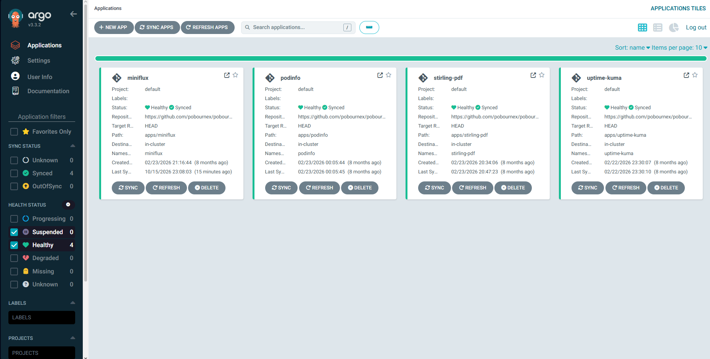
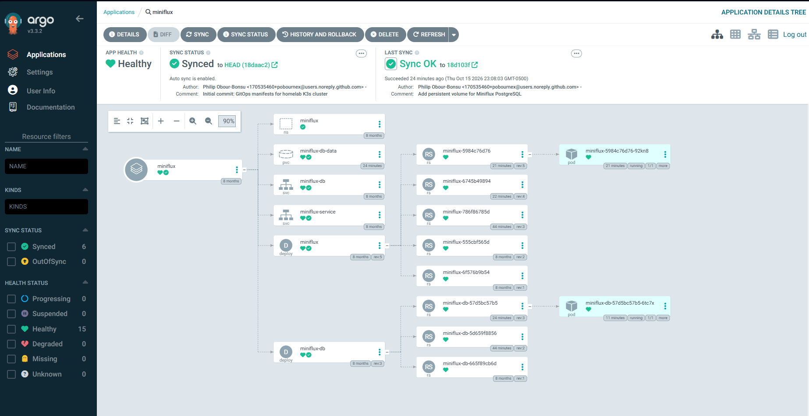
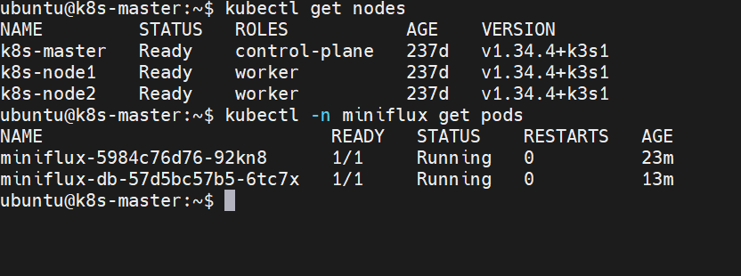

# pobournex-cluster-ops

GitOps repository for my homelab Kubernetes cluster. [Argo CD](https://argo-cd.readthedocs.io/) watches this repo and automatically syncs each application's manifests to the cluster.

## Cluster

- 3-node K3s cluster (1 control plane, 2 workers) on Proxmox VE
- MetalLB for LoadBalancer IPs and ingress-nginx for HTTP routing (installed separately from this repo)
- Argo CD for continuous delivery, with auto-sync enabled

## Applications

| App | Path | Namespace |
|-----|------|-----------|
| Miniflux (RSS reader, with PostgreSQL) | `apps/miniflux` | `miniflux` |
| Podinfo (demo app) | `apps/podinfo` | `podinfo` |
| Stirling-PDF | `apps/stirling-pdf` | `stirling-pdf` |
| Uptime Kuma | `apps/uptime-kuma` | `uptime-kuma` |

## How it works

1. Each application has its own folder under `apps/` containing its Kubernetes manifests.
2. An Argo CD Application points at that folder on the `main` branch and deploys it to its own namespace.
3. Changes are made by committing to Git. Argo CD detects the new commit and syncs it to the cluster.

## Secrets

No secrets are stored in this repository. Credentials (for example the Miniflux database and admin passwords) live in Kubernetes Secrets created directly in the cluster and are referenced from the manifests with `secretKeyRef`.

## Storage

The Miniflux PostgreSQL database uses a PersistentVolumeClaim (`local-path`), so data survives pod restarts.

## Stack

Kubernetes (K3s) · Argo CD · MetalLB · ingress-nginx · Proxmox VE · YAML manifests

## History

The cluster and these Argo CD applications have been running since February 2026. This repository was republished in October 2026 with a fresh Git history, after credentials that were in early commits were rotated and moved into Kubernetes Secrets.

## Screenshots

Argo CD showing all four applications Synced and Healthy:

The detailed views below use Miniflux as the example; the other apps follow the same pattern.

Resource tree for the Miniflux app, including the PostgreSQL PersistentVolumeClaim:

The 3-node K3s cluster and the running Miniflux pods:

